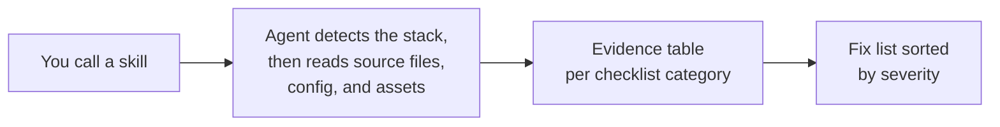

# Web & UI/UX Audit Skills

> AI coding agent skills that audit websites and web apps against fixed engineering checklists: UI/UX polish, responsiveness, performance, SEO, animations, security, and production readiness.

<p align="center">
  
  
  
  
  
</p>

---

## Overview

Each skill in this repository reads your codebase and reports what is applied and what is missing. Results are structured as evidence tables: every item gets a status and a file path and line reference. Every gap gets a severity and a concrete fix.

All three skills are **user-invoked only** (`disable-model-invocation: true`). Agents that honor that flag run them only when you call them by name, not in the background on every file edit.



### Status values

| Status | Meaning |
|---|---|
| Applied | The item is implemented. A file and line is cited as evidence. |
| Missing | The item is not implemented. |
| Partial | The item is implemented in some places but not others, or only in part. |
| N/A | The project does not use the tool or feature the item depends on (for example GSAP or Supabase). A one-line reason is given. |
| Manual | The item cannot be verified from source. The report states exactly what to check by hand. |

### Severity

Every Missing or Partial item gets one of three severities, and the fix list is sorted Critical first.

| Severity | Meaning |
|---|---|
| Critical | Security, data loss, or legal exposure |
| High | User-facing breakage, SEO or performance blockers |
| Low | Polish |

### Stack coverage

The checklists lean toward JavaScript projects (Next.js, React, Vite, Astro). Each skill detects the stack first and reports N/A for items that do not apply, instead of failing the project for tooling it does not use. Laravel and PHP projects are detected through `composer.json` and `artisan`, and the fix templates include Laravel equivalents for the main security and validation items.

---

## Skills

### [`/ui-ux-audit`](skills/ui-ux-audit/SKILL.md)

Audits components and pages for interaction polish, form correctness, loading behavior, and user-flow completeness.

| Category | What Gets Checked |
|---|---|
| Buttons & Touch Feedback | Submit locks on first tap, frozen button dimensions during loading, tap feedback, action-oriented labels, one clear CTA per screen, all interactive elements wired |
| Loading States | Skeleton gated on `isLoading` only (not `isFetching`), stale-while-revalidate, splash screen held until auth resolves, optimistic updates |
| Forms & Inputs | Email trimmed and lowercased on `blur`, name fields allow Unicode and apostrophes, `autocomplete` wired, inline `aria-invalid` errors, invalid submit explains itself |
| Media & Uploads | Client-side compression before upload, MIME and size validation, upload progress |
| State & Resilience | Draft persistence to `sessionStorage`/`localStorage`, UTC storage with local timezone render, offline banner, retry on reconnect |
| Onboarding, Help & Flows | FAQ accordions keyboard-accessible, onboarding has visible skip and step indicator, password reset gives neutral feedback with cooldown |
| Accessibility & Visual | WCAG AA color contrast, visible focus styles, label association, custom branded 404 page with recovery link |

Fix templates: [`skills/ui-ux-audit/references/fixes.md`](skills/ui-ux-audit/references/fixes.md).

---

### [`/website-audit`](skills/website-audit/SKILL.md)

Audits a full web project, located from `package.json`, `composer.json`, `index.html`, or a framework config, across five technical categories.

| Category | What Gets Checked |
|---|---|
| Responsiveness | Layout across 320px to 1400px, `clamp()` for fluid scaling, 3D canvas not mounted below 1100px |
| Performance & Optimization | `.webp` images, `.svg` icons, `.woff2` fonts, lazy loading, alt text on all images, layout shift prevention, CDN delivery, preloading |
| SEO | `<title>`, `<meta description>`, Open Graph tags, `favicon.ico`/`.png`, canonical tags, `robots.txt`, `sitemap.xml` |
| Validation & Security | Broken links, rate-limited API routes, server-side validation, error handling, Supabase RLS, spam protection |
| Animations & Motion | GSAP `ctx.revert()` cleanup, Lenis lifecycle, Three.js resize and RAF disposal, WebGL context loss handling, GPU-only properties, `prefers-reduced-motion` |

Secrets, HTTPS, and security headers are checked by `/production-audit`, not here, so the two skills do not report the same finding twice.

Fix templates: [`skills/website-audit/references/fixes.md`](skills/website-audit/references/fixes.md).

---

### [`/production-audit`](skills/production-audit/SKILL.md)

Audits a web project for production readiness: legal compliance, analytics, error monitoring, infrastructure hardening, database operations, and authentication flows.

| Category | What Gets Checked |
|---|---|
| Legal & Privacy | Privacy policy and Terms of Service pages exist and are linked in footer, cookie consent banner blocks non-essential scripts until accepted |
| Analytics & Monitoring | Analytics configured (GA4, Plausible, PostHog), client and server error monitoring (Sentry), uptime monitoring |
| Infrastructure & HTTPS | HTTPS enforced, security headers set, no exposed API keys in client code, `.env.example` present |
| Database & Backend Ops | Connection pooling for serverless, DB backups configured, payment idempotency keys, safe account deletion, private storage buckets |
| Auth & Critical Flows | Signup, login, and password reset flows complete with neutral error messages, post-auth redirect, session expiry handling, password hashing |

Fix templates: [`skills/production-audit/references/fixes.md`](skills/production-audit/references/fixes.md).

---

## Installation

### Via `npx skills add` (Recommended)

Install directly to your current project:
```bash
npx skills add shanshan-3/web-and-uiux-auditskills
```

Target a specific agent using the `-a` flag:
```bash
# Claude Code
npx skills add shanshan-3/web-and-uiux-auditskills -a claude-code

# Cursor
npx skills add shanshan-3/web-and-uiux-auditskills -a cursor

# OpenCode
npx skills add shanshan-3/web-and-uiux-auditskills -a opencode
```

Install globally across all projects using `-g`:
```bash
npx skills add shanshan-3/web-and-uiux-auditskills -g
```

Or install an individual skill:
```bash
npx skills add shanshan-3/web-and-uiux-auditskills --skill ui-ux-audit
npx skills add shanshan-3/web-and-uiux-auditskills --skill website-audit
npx skills add shanshan-3/web-and-uiux-auditskills --skill production-audit
```

---

### Manual Installation by Agent

Clone the repository and copy the `skills/` folder to your agent's directory:

```bash
git clone https://github.com/shanshan-3/web-and-uiux-auditskills.git temp-skills
```

| Agent | Project Scope | Global Scope |
|---|---|---|
| **Claude Code** | `cp -r temp-skills/skills/* .claude/skills/` | `cp -r temp-skills/skills/* ~/.claude/skills/` |
| **Cursor** | `cp -r temp-skills/skills/* .cursor/skills/` | `cp -r temp-skills/skills/* ~/.agents/skills/` |
| **OpenCode** | `cp -r temp-skills/skills/* .opencode/skills/` | `cp -r temp-skills/skills/* ~/.config/opencode/skills/` |
| **Codex / Antigravity / Universal** | `cp -r temp-skills/skills/* .agents/skills/` | `cp -r temp-skills/skills/* ~/.agents/skills/` |

Clean up after copying:
```bash
rm -rf temp-skills
```

---

## Usage

In a Claude Code, OpenCode, Codex, Antigravity, or Cursor session:

```text
/ui-ux-audit
```
```text
/website-audit
```
```text
/production-audit
```

The agent detects your stack, reads your files, then outputs a table per category followed by a fix list sorted by severity:

### Responsiveness
| Item | Status | File / Evidence |
|---|---|---|
| Fluid scaling with clamp() | Applied | src/styles/typography.css:14 |
| Canvas hidden below 1100px | Missing | components/HeroScene.tsx:28 - no viewport guard |
| Mobile layout (320px-480px) | Partial | components/PricingTable.tsx:45 - overflow |
| Tablet landscape (768px-1024px) | Manual | Test in browser devtools at 768, 900, and 1024px |
| Lenis smooth scroll | N/A | Lenis is not installed in this project |

### Fixes
1. [High] Canvas hidden below 1100px - HeroScene.tsx: mount the canvas only when `(min-width: 1100px)` matches.
2. [High] Mobile layout - PricingTable.tsx: stack the grid to a single column on mobile.

### Manual checks
- Tablet landscape: open devtools, test at 768, 900, and 1024px, and confirm there is no horizontal scroll.

---

## Repository layout

```text
skills/
  ui-ux-audit/
    SKILL.md
    references/fixes.md
  website-audit/
    SKILL.md
    references/fixes.md
  production-audit/
    SKILL.md
    references/fixes.md
```

---

## Compatibility

All skills follow the [Agent Skills open standard](https://agentskills.io/specification). They work with any agent that supports `.agents/skills/` or `.claude/skills/` directories.

| Agent | Supported |
|---|---|
| Claude Code | Yes |
| OpenCode | Yes |
| Codex | Yes |
| Google Antigravity | Yes |
| Cursor | Yes |

---

## License

[MIT](LICENSE)