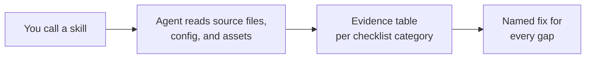

# Web & UI/UX Audit Skills

> AI coding agent skills that audit websites and web apps against fixed engineering checklists.

<p align="center">
  
  
  
  
  
</p>

---

## Overview

Each skill in this repository reads your codebase and reports what is applied and what is missing. Results are structured as evidence tables — every item gets a `✅ Applied`, `❌ Missing`, or `⚠️ Partial` status with a file path and line reference. Every gap gets a concrete fix.

Both skills are **user-invoked only** (`disable-model-invocation: true`). They run when you call them — not in the background on every file edit.



---

## Skills

### [`/ui-ux-audit`](skills/ui-ux-audit/SKILL.md)

Audits components and pages for interaction polish, form correctness, loading behavior, and user-flow completeness.

| Category | What Gets Checked |
|---|---|
| Buttons & Feedback | Submit locks on first tap, frozen button dimensions during loading, 100ms visual feedback, action-oriented labels |
| Loading States | Skeleton gated on `isLoading` only (not `isFetching`), stale-while-revalidate, splash screen held until auth resolves |
| Forms & Inputs | Email trimmed and lowercased on `blur`, name fields allow Unicode and apostrophes, `autocomplete` wired, inline `aria-invalid` errors |
| Media & State | Client-side compression before upload, draft persistence to `sessionStorage`/`localStorage`, UTC storage with local timezone render |
| Flows & Help | FAQ accordions keyboard-accessible, onboarding has visible skip + step indicator, password reset gives neutral feedback with cooldown |

---

### [`/website-audit`](skills/website-audit/SKILL.md)

Audits a full web project — located from `package.json`, `index.html`, or a framework config — across five technical categories.

| Category | What Gets Checked |
|---|---|
| Responsiveness | Layout across 320px–1400px, `clamp()` for fluid scaling, 3D canvas hidden below 1100px |
| Performance | `.webp` images, `.svg` icons, `.woff2` fonts, lazy loading, layout shift prevention, Cloudinary or CDN delivery |
| SEO | `<title>`, `<meta description>`, Open Graph tags, `favicon.ico`/`.png`, canonical tags, `robots.txt`, `sitemap.xml` |
| Validation & Security | Broken links, rate-limited API routes, server-side Zod validation, Supabase Row-Level Security policies |
| Animations & Motion | GSAP `ctx.revert()` cleanup, Lenis lifecycle, Three.js resize and RAF disposal, WebGL context loss handling, GPU-only properties, `prefers-reduced-motion` |

Fix templates with copy-pasteable code for every failing item live in [`skills/website-audit/references/fixes.md`](skills/website-audit/references/fixes.md).

---

## Installation

### Via `npx skills add` (Recommended)

Install directly to your current project:
```bash
npx skills add shanshan-3/web-and-uiux-auditskills
```

Target a specific agent using the `-a` flag:
```bash
# Claude Code
npx skills add shanshan-3/web-and-uiux-auditskills -a claude-code

# Cursor
npx skills add shanshan-3/web-and-uiux-auditskills -a cursor

# OpenCode
npx skills add shanshan-3/web-and-uiux-auditskills -a opencode
```

Install globally across all projects using `-g`:
```bash
npx skills add shanshan-3/web-and-uiux-auditskills -g
```

Or install an individual skill:
```bash
npx skills add shanshan-3/web-and-uiux-auditskills --skill ui-ux-audit
npx skills add shanshan-3/web-and-uiux-auditskills --skill website-audit
```

---

### Manual Installation by Agent

Clone the repository and copy the `skills/` folder to your agent's directory:

```bash
git clone https://github.com/shanshan-3/web-and-uiux-auditskills.git temp-skills
```

| Agent | Project Scope | Global Scope |
|---|---|---|
| **Claude Code** | `cp -r temp-skills/skills/* .claude/skills/` | `cp -r temp-skills/skills/* ~/.claude/skills/` |
| **Cursor** | `cp -r temp-skills/skills/* .cursor/skills/` | `cp -r temp-skills/skills/* ~/.agents/skills/` |
| **OpenCode** | `cp -r temp-skills/skills/* .opencode/skills/` | `cp -r temp-skills/skills/* ~/.config/opencode/skills/` |
| **Codex / Antigravity / Universal** | `cp -r temp-skills/skills/* .agents/skills/` | `cp -r temp-skills/skills/* ~/.agents/skills/` |

Clean up after copying:
```bash
rm -rf temp-skills
```

---

## Usage

In a Claude Code, OpenCode, Codex, Antigravity, or Cursor session:

```text
/ui-ux-audit
```
```text
/website-audit
```

The agent reads your files, then outputs a table per category:

### Responsiveness
| Item | Status | File / Evidence |
|---|---|---|
| Fluid scaling with clamp() | ✅ | src/styles/typography.css:14 |
| Canvas hidden below 1100px | ❌ | components/HeroScene.tsx:28 — no viewport guard |
| Mobile layout (320px–480px) | ⚠️ | components/PricingTable.tsx:45 — overflow |

### Fixes
- HeroScene.tsx: wrap canvas in `hidden min-[1100px]:block`.
- PricingTable.tsx: stack grid to single column on mobile.

---

## Compatibility

Both skills follow the [Agent Skills open standard](https://agentskills.io/specification). They work with any agent that supports `.agents/skills/` or `.claude/skills/` directories.

| Agent | Supported |
|---|---|
| Claude Code | ✅ |
| OpenCode | ✅ |
| Codex | ✅ |
| Google Antigravity | ✅ |
| Cursor | ✅ |

---

## License

[MIT](LICENSE)
